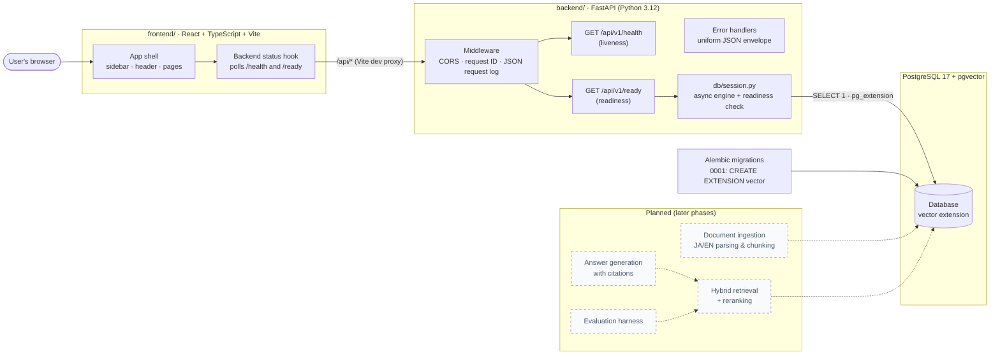
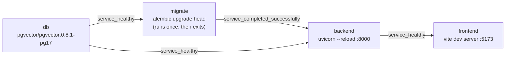

# Architecture

This document describes what exists after **Phase 1 (Foundation)** and where planned
components will fit. Anything marked *planned* is not implemented yet.

## System overview

## Components

### Backend (`backend/`)

| Module | Responsibility |
| --- | --- |
| `app/main.py` | `create_app()` factory: logging, lifespan (engine create/dispose), middleware, routers |
| `app/core/config.py` | `Settings` (pydantic-settings). All configuration comes from environment variables or a `.env` file; `DATABASE_URL` has no default |
| `app/core/logging.py` | Standard-library JSON log formatter; uvicorn logs are routed through it |
| `app/core/errors.py` | Exception handlers producing `{"error": {"code", "message", "request_id"}}` |
| `app/db/session.py` | Async SQLAlchemy engine (psycopg 3 driver) and `check_database()` |
| `app/api/v1/health.py` | `/health` and `/ready` endpoints |
| `alembic/` | Migration environment; reads `DATABASE_URL` through the same `Settings` class |

**Liveness vs readiness.** `/api/v1/health` never touches the database: it answers "is the
process up?", which is what a container health check or restart policy should use.
`/api/v1/ready` answers "can this instance serve real traffic?": it runs `SELECT 1` and
checks that the `vector` extension exists (meaning migrations have been applied). It returns
`200` when both succeed and `503` otherwise, with a short reason that does not expose hosts
or credentials. The check has a timeout so a hung database cannot hang the endpoint.

**Request handling.** Every request gets an `X-Request-ID` (taken from the incoming header
if it is safe, otherwise generated). The ID is returned in the response header, included in
error bodies, and attached to every log line written during the request. Unhandled
exceptions are logged with a traceback and returned as a generic `500` without internal
details.

**CORS.** Allowed origins are an explicit list from `CORS_ALLOWED_ORIGINS`. A wildcard
(`*`) is rejected at startup. In local development the frontend calls the API through the
Vite proxy (same origin), so CORS only matters when the frontend is served from a
different origin.

**One database driver.** psycopg 3 supports both sync and async use, so the application
(async SQLAlchemy) and Alembic (sync) share the same `postgresql+psycopg://` URL.

### Database

PostgreSQL 17 with pgvector 0.8.1 (`pgvector/pgvector:0.8.1-pg17`). Phase 1 creates only
the `vector` extension; there are no application tables yet. See
[ADR 0002](decisions/0002-postgres-pgvector.md) for why pgvector was chosen.

### Frontend (`frontend/`)

React 19 + TypeScript + Vite + Tailwind CSS v4, with React Router for navigation.

| Path | Responsibility |
| --- | --- |
| `src/components/AppLayout.tsx` | Sidebar + header + routed page; owns the backend status poller |
| `src/components/Sidebar.tsx` | Navigation; becomes an off-canvas drawer below the `lg` breakpoint |
| `src/hooks/useBackendStatus.ts` | Polls `/health` and `/ready` every 15 s; states: checking, online, degraded, offline |
| `src/lib/api.ts` | Small typed `fetch` wrapper with a request timeout |
| `src/pages/*` | Dashboard (live system status) and placeholders for Documents, Chat, Evaluation |

The Documents, Chat and Evaluation pages are explicit placeholders labelled
"Coming in a later milestone". They contain no mock data.

### Local runtime (Docker Compose)

- `db` is healthy when `pg_isready` succeeds; data is kept in the `postgres-data` volume.
- `migrate` uses the backend image to apply migrations before the API starts.
- `backend` is healthy when `/api/v1/health` responds; its source is mounted read-only for
  auto-reload.
- `frontend` proxies `/api` to `http://backend:8000`.
- All ports are published on `127.0.0.1` only.

### CI (`.github/workflows/ci.yml`)

Three parallel jobs on every push to `main` and every pull request:

1. **Backend**: Ruff lint, Ruff format check, `alembic upgrade head` against a pgvector
   service container, then the full pytest suite (unit and integration tests).
2. **Frontend**: `npm ci`, `tsc -b`, `vite build`.
3. **Compose**: `docker compose config` validation.

There is no deployment step.

## Planned architecture (not implemented)

The intended request path for later phases, recorded here so that Phase 1 choices can be
checked against it:

1. **Ingestion**: upload → language detection → parsing → chunking (separate strategies
   for Japanese and English) → embeddings → `documents` / `chunks` tables with a pgvector
   column.
2. **Retrieval**: vector similarity + keyword search, merged (for example with reciprocal
   rank fusion), then reranked.
3. **Generation**: answer composed only from retrieved passages, returned with citations.
4. **Evaluation**: a fixed bilingual question set with retrieval metrics and answer checks,
   so changes to chunking, retrieval or prompts can be compared.

Model and provider choices for embeddings, reranking and generation are deliberately not
made yet; each will get an ADR when it is.
