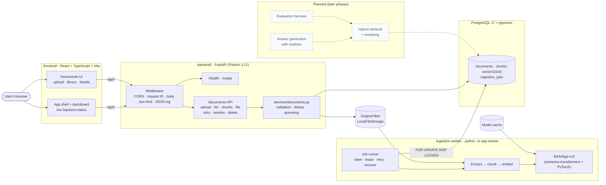
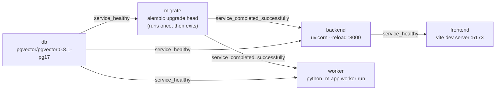

# Architecture

This document describes what exists after **Phase 2 (Ingestion)** and where planned
components will fit. Anything marked *planned* is not implemented yet. The ingestion
pipeline itself is described in detail in [ingestion-pipeline.md](ingestion-pipeline.md).

## System overview

## Components

### Backend (`backend/`)

| Module | Responsibility |
| --- | --- |
| `app/main.py` | `create_app()` factory: logging, lifespan (engine create/dispose), middleware, routers |
| `app/core/config.py` | `Settings` (pydantic-settings). All configuration comes from environment variables or a `.env` file; `DATABASE_URL` has no default |
| `app/core/logging.py` | Standard-library JSON log formatter; uvicorn logs are routed through it |
| `app/core/errors.py` | `ApiError` and exception handlers producing `{"error": {"code", "message", "request_id"}}` |
| `app/core/limits.py` | Request body size limit (rejects oversized uploads with `413` before they are read) |
| `app/db/session.py` | Async SQLAlchemy engine (psycopg 3 driver), session factory and `check_database()` |
| `app/db/models.py` | ORM models and status enums for `documents`, `chunks` and `ingestion_jobs` |
| `app/api/v1/health.py` | `/health` and `/ready` endpoints |
| `app/api/v1/documents.py`, `schemas.py` | Document management endpoints and their response models |
| `app/services/documents.py` | Upload (spool, hash, validate, deduplicate, store, queue), listing, retry, reindex, delete |
| `app/storage.py` | `DocumentStorage` interface and `LocalFileStorage` ([ADR 0004](decisions/0004-document-storage.md)) |
| `app/ingestion/` | Validation, extraction, language detection, chunking, the job queue and state machine, and the extract → chunk → embed pipeline |
| `app/embeddings/` | `EmbeddingProvider` interface, BGE-M3 provider, test-only fake provider ([ADR 0003](decisions/0003-local-bge-m3.md)) |
| `app/worker/` | Worker process: `run`, `prepare-model` and `healthcheck` commands |
| `alembic/` | Migration environment; reads `DATABASE_URL` through the same `Settings` class |

**Liveness vs readiness.** `/api/v1/health` never touches the database: it answers "is the
process up?", which is what a container health check or restart policy should use.
`/api/v1/ready` answers "can this instance serve real traffic?": it runs `SELECT 1` and
checks that the `vector` extension exists (meaning migrations have been applied). It returns
`200` when both succeed and `503` otherwise, with a short reason that does not expose hosts
or credentials. The check has a timeout so a hung database cannot hang the endpoint.

**Request handling.** Every request gets an `X-Request-ID` (taken from the incoming header
if it is safe, otherwise generated). The ID is returned in the response header, included in
error bodies, and attached to every log line written during the request. Unhandled
exceptions are logged with a traceback and returned as a generic `500` without internal
details.

**CORS.** Allowed origins are an explicit list from `CORS_ALLOWED_ORIGINS`. A wildcard
(`*`) is rejected at startup. In local development the frontend calls the API through the
Vite proxy (same origin), so CORS only matters when the frontend is served from a
different origin.

**One database driver.** psycopg 3 supports both sync and async use, so the application
(async SQLAlchemy) and Alembic (sync) share the same `postgresql+psycopg://` URL.

**Dependencies.** Runtime and dev dependencies are declared in `pyproject.toml` (dev tools in
a PEP 735 `dev` dependency group) and resolved into the committed `uv.lock`. CI and the
Docker images install with `uv sync --locked`, so they use exactly the locked versions. The
model libraries (sentence-transformers, PyTorch) are an optional extra, `embeddings`,
installed only for the worker.

**API and worker are separate processes.** The API validates and stores uploads and writes
a job row; it never imports PyTorch. The worker polls PostgreSQL for jobs, so the API does
not need to know whether a worker is running, and documents simply stay `pending` until one
is. Both share the database and the file storage, nothing else.

**Uploads.** Endpoints under `/api/v1/documents`:

| Method and path | Purpose |
| --- | --- |
| `GET /documents/limits` | Accepted extensions and the size limit, for the UI |
| `POST /documents` | Upload one file. `202` for a new document, `200` with `duplicate: true` for known content |
| `GET /documents` | Paginated list, optional `status` filter |
| `GET /documents/{id}` | Details, including the latest job |
| `GET /documents/{id}/chunks` | Paginated chunk previews (text, pages, section, tokens; no vectors) |
| `GET /documents/{id}/file` | The original file (`?download=true` for an attachment) |
| `POST /documents/{id}/retry` | Re-queue a failed document |
| `POST /documents/{id}/reindex` | Rebuild the index of a completed or failed document |
| `DELETE /documents/{id}` | Delete the document, its chunks, jobs and stored file |

The original file is served with `X-Content-Type-Options: nosniff` and a sandboxing
`Content-Security-Policy`, so an uploaded file cannot run script in the app's origin.

### Database

PostgreSQL 17 with pgvector 0.8.1 (`pgvector/pgvector:0.8.1-pg17`). See
[ADR 0002](decisions/0002-postgres-pgvector.md) for why pgvector was chosen.

| Migration | Adds |
| --- | --- |
| `0001_enable_pgvector` | The `vector` extension |
| `0002_documents` | `documents`, `chunks` (with `embedding vector(1024)`) and `ingestion_jobs`, with CHECK constraints for every status invariant |

Columns and constraints are listed in [ingestion-pipeline.md](ingestion-pipeline.md#schema).
There is no vector index yet; it will be chosen with retrieval.

### Frontend (`frontend/`)

React 19 + TypeScript + Vite + Tailwind CSS v4, with React Router for navigation.

| Path | Responsibility |
| --- | --- |
| `src/components/AppLayout.tsx` | Sidebar + header + routed page; owns the backend status poller |
| `src/components/Sidebar.tsx` | Navigation; becomes an off-canvas drawer below the `lg` breakpoint |
| `src/hooks/useBackendStatus.ts` | Polls `/health` and `/ready` every 15 s; states: checking, online, degraded, offline |
| `src/lib/api.ts` | Typed API client: health checks, document endpoints, and uploads via `XMLHttpRequest` (for progress events) |
| `src/hooks/usePolledResource.ts` | Loads a resource and polls it while `shouldPoll` is true, backing off from 2 s to 10 s |
| `src/components/documents/*` | Upload panel (drag and drop), document table and cards, status badge, pagination, confirmation dialog |
| `src/pages/DocumentsPage.tsx` | Upload and library with a status filter; polls while documents are pending or processing |
| `src/pages/DocumentDetailPage.tsx` | Metadata, latest job, errors, chunk previews, download, retry, reindex and delete |
| `src/pages/*` | Dashboard (live system status), and placeholders for Chat and Evaluation |

The Chat and Evaluation pages are explicit placeholders labelled "Coming in a later
milestone". They contain no mock data. Frontend tests use Vitest, jsdom and Testing Library
(`src/**/*.test.tsx`).

### Local runtime (Docker Compose)

- `db` is healthy when `pg_isready` succeeds; data is kept in the `postgres-data` volume.
- `migrate` uses the API image to apply migrations before the API and worker start.
- `backend` (Dockerfile target `api`) is healthy when `/api/v1/health` responds; its source
  is mounted read-only for auto-reload, and uploads go to the `uploads` volume.
- `worker` (Dockerfile target `worker`) has the embeddings extra installed, mounts
  `uploads` and the `model-cache` volume, and is healthy while its heartbeat file is fresh.
  It is limited to 4 CPUs and 6 GB by default and gets 45 seconds to shut down gracefully.
  Model weights are downloaded at runtime, never at build time.
- `frontend` proxies `/api` to `http://backend:8000`.
- All ports are published on `127.0.0.1` only.

### CI (`.github/workflows/ci.yml`)

Three parallel jobs on every push to `main` and every pull request:

1. **Backend**: `uv sync --locked` (fails if `uv.lock` is out of date; the `embeddings`
   extra is not installed), Ruff lint, Ruff format check, `alembic upgrade head` against a
   pgvector service container, `alembic check` (models match migrations), then the full
   pytest suite (unit and integration tests, with the fake embedding provider). The
   real-model smoke test is skipped.
2. **Frontend**: `npm ci`, oxlint (warnings fail the job), `tsc -b`, Vitest, `vite build`.
3. **Compose**: `docker compose config` validation, including that the worker service is
   defined.

There is no deployment step.

## Planned architecture (not implemented)

The intended request path for later phases, recorded here so that current choices can be
checked against it:

1. **Ingestion** (Phase 2, implemented): upload → validation → extraction → language
   detection → chunking → BGE-M3 embeddings → `documents` / `chunks`.
2. **Retrieval**: vector similarity over `chunks.embedding` (with an ANN index chosen by
   measurement) plus keyword search, merged (for example with reciprocal rank fusion), then
   reranked. Japanese keyword search needs its own tokenization decision (ADR 0002).
3. **Generation**: answer composed only from retrieved passages, returned with citations
   (chunks already carry page numbers and sections for that).
4. **Evaluation**: a fixed bilingual question set with retrieval metrics and answer checks,
   so changes to chunking, retrieval or prompts can be compared.

Reranker and answer-generation models are deliberately not chosen yet; each will get an
ADR when it is.
