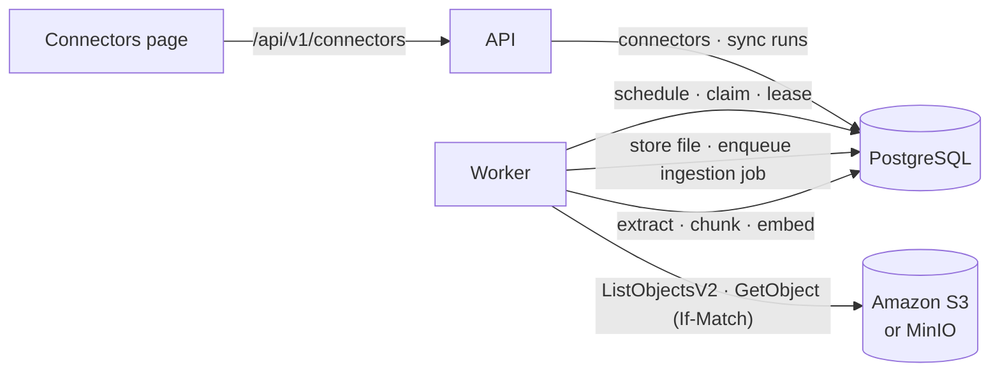

# S3 connectors

Phase 5 lets YashRAG import documents from Amazon S3 and keep them in sync. A **connector**
points at one bucket and an optional prefix (a "folder"). The backend worker lists the
objects under it, imports PDF, Markdown and text files through the same ingestion pipeline
as uploads, and on every later sync imports new objects, re-indexes changed ones and
removes documents whose objects were deleted. Uploaded documents are never touched.

- Setup (credentials, IAM policy, MinIO): [s3-setup.md](s3-setup.md)
- HTTP API: [connectors-api.md](connectors-api.md)
- Smoke tests against MinIO or a real bucket: [s3-smoke-tests.md](s3-smoke-tests.md)
- Why it works this way: [ADR 0011](decisions/0011-s3-sync-and-deletion.md)

> **Local development only.** YashRAG has no authentication. Anyone who can reach the API
> can create connectors for the allowed buckets, start syncs and read every imported
> document. Do not expose the stack to a network you do not trust.

## How it fits together

- The **API** validates connectors and queues sync runs. It never contacts S3 and has no
  AWS credentials.
- The **worker** is the only process that talks to S3. It schedules due syncs, runs them,
  and then indexes the imported files with its existing ingestion job loop. There is no
  separate service, Celery or Redis: sync runs are rows in `connector_sync_runs`, claimed
  with the same lease protocol as ingestion jobs.
- **Credentials** come from the worker's environment: `AWS_ACCESS_KEY_ID` /
  `AWS_SECRET_ACCESS_KEY`, `AWS_PROFILE`, or an IAM role. They are never stored in
  PostgreSQL, never accepted or returned by the API, and never logged.

## What gets imported

| Object | Result |
| --- | --- |
| `.pdf`, `.md`, `.markdown`, `.txt` (case-insensitive), up to `S3_MAX_OBJECT_BYTES` (20 MiB) | Imported and indexed |
| Any other extension | Skipped (`unsupported_file_type`), not downloaded |
| Larger than the limit (by its listed size, or while downloading) | Failed (`object_too_large`), not retried until it changes |
| Unsafe key: `..` or `.` segments, a leading `/`, backslashes, control characters, more than 1024 bytes | Skipped (`unsafe_object_key`), not downloaded |
| Folder markers (keys ending in `/`, size 0) | Ignored |
| Content that fails validation (wrong type, empty, broken PDF) | Failed with the same error as an upload |

The document's filename is the last segment of the key (`handbook/経費精算.txt` becomes
`経費精算.txt`). Files are always stored under a server-generated name; the object key is
never used as a path on disk.

Each imported document shows its source on the Documents page and in
`GET /api/v1/documents/{id}` (`source`): connector, `s3://bucket/key`, ETag, version ID (on
versioned buckets), size, last-modified time and when it was last synced.

## Sync semantics

A sync run, in order:

1. **List** every object under the prefix with `ListObjectsV2`, page by page
   (`S3_LIST_PAGE_SIZE`, at most `S3_MAX_OBJECTS_PER_SYNC` objects). If listing fails, the
   run fails or retries and **nothing is deleted**.
2. **Compare** each object with what was imported last time (`connector_objects`). An
   object is *unchanged* when both its ETag and size match. ETags are compared as opaque
   strings: they are not assumed to be MD5 hashes (multipart and KMS-encrypted objects have
   other ETags). Unchanged objects are not downloaded.
3. **Import** new and changed objects one at a time. Each is downloaded with
   `If-Match: <listed ETag>`, so the bytes are exactly the listed version; if the object
   changed in between, it is retried on the next sync (`object_changed`). The download
   stops at the size limit. The file is validated like an upload, stored, and committed in
   one transaction with its ingestion job.
4. **Delete** documents whose objects are no longer listed, but only if the listing
   completed and the run was not cancelled.

### Never a mixed revision

When an object changes, its old chunks are deleted in the same transaction that points the
document at the new file and queues re-indexing. Search and chat therefore see either the
old revision or nothing, then the new revision once it is indexed, and never a mix of old
and new chunks. While re-indexing runs, the document is briefly not searchable. Citations in
earlier chat answers keep their stored excerpt and are reported as `changed`.

If a document is still being indexed when its object changes again, the change waits for
the next sync (`document_busy`) instead of interrupting the running job.

### Deletion policy

- Deletion only happens after a **complete, successful listing** of the prefix. A failed,
  truncated, timed-out or cancelled listing deletes nothing.
- Only documents **imported by that connector** can be deleted. Manual uploads are never
  affected, even when they have the same content: content de-duplication applies to
  uploads only.
- Deleted documents go through the normal document deletion path: chunks, ingestion jobs
  and the stored file are removed, and earlier chat citations keep their excerpt with the
  status `deleted`.
- The `connector_objects` row is kept with `status = 'deleted'` and `deleted_at`, as the
  audit record (key, last ETag, version ID, size).
- If an object comes back, it is imported again as a new document.
- If you delete an imported document by hand, the next sync imports it again while its
  object still exists. To stop importing it, remove the object or narrow the connector.

### Run outcomes

| Status | Meaning |
| --- | --- |
| `pending` | Queued; waits for a worker (or for its retry time) |
| `running` | A worker holds its lease |
| `succeeded` | Listing completed, every object handled |
| `partial` | Listing completed and deletions applied, but some objects failed; they are retried by the next run |
| `failed` | The listing could not be completed (or the source is no longer allowed); nothing was deleted |
| `cancelled` | Stopped on request; objects already imported stay, nothing was deleted |

Run-level errors (`credentials_missing`, `access_denied`, `bucket_not_found`,
`wrong_region`, `s3_unreachable`, `s3_unavailable`, `too_many_objects`, ...) have messages that
name the problem without echoing credentials, signatures, request IDs or endpoint URLs. A
run records at most 50 object failures (`key`, `code`, `message`).

## Scheduling and the worker

- Each connector has an interval (5 minutes to 7 days, default 60 minutes). `enabled`
  controls only automatic syncs; **Sync now** always works.
- The worker schedules due syncs itself, using database time (`next_sync_at <= now()`), so
  scheduling does not depend on the browser and survives restarts. After a run finishes,
  `next_sync_at` moves to `now() + interval`.
- **One active run per connector**, enforced by a partial unique index. Several workers can
  run at once: the scheduler's insert is `ON CONFLICT DO NOTHING`, and runs are claimed
  with `FOR UPDATE SKIP LOCKED`. A manual sync while one is queued or running returns the
  existing run.
- **Leases and recovery.** A running sync renews its lease. If the worker dies, the lease
  expires and the run is requeued (`worker_lost`), counting as an attempt. Every write is
  fenced by the run's lease token, so a worker that lost its lease cannot commit more
  changes. Re-running a sync is idempotent: unchanged objects are skipped and an object is
  never imported twice.
- **Retries** for transient failures (network errors, S3 5xx, throttling): up to
  `CONNECTOR_SYNC_MAX_ATTEMPTS` (3) per run, waiting 30 s, 60 s, 120 s ... capped at 15
  minutes. botocore also retries individual requests (`S3_MAX_ATTEMPTS`). Permanent
  failures (access denied, missing bucket) fail at once.
- **Cancellation.** A queued run is cancelled immediately. A running run stops before its
  next object; deletions are skipped.
- **Graceful shutdown.** On SIGTERM a running sync stops between objects and is put back in
  the queue without using up an attempt.
- `CONNECTOR_SYNC_CONCURRENCY` (default 1) syncs run per worker, alongside ingestion jobs.

The Connectors page polls only while a sync is queued or running.

## Safety rules

- **Allowlist.** `S3_ALLOWED_SOURCES` lists the buckets (`team-docs`) or bucket scopes
  (`team-docs/policies/`) connectors may use. Without it, connectors cannot be created
  (`503 connectors_not_configured`). The worker checks the allowlist again on every run, so
  removing a source stops its syncs (`source_not_allowed`) without deleting anything.
- **No overlap.** Two connectors cannot cover the same objects (`409 connector_overlap`),
  so a document always belongs to exactly one connector.
- **Immutable source.** Bucket and prefix cannot be changed after creation; create a new
  connector instead.
- **No client-controlled endpoints.** The API accepts no endpoint URL. `S3_ENDPOINT_URL` is
  a server-side setting for emulators, must be `scheme://host[:port]`, and is never
  returned (the API reports only whether an override is in use).
- **Bounded work.** Object size, objects per sync, page size and timeouts are all limited by
  settings.
- **Logs** carry IDs, counts, error codes and object keys, never document contents or
  credentials; botocore's own loggers are capped at `WARNING`.

## Deleting a connector

`DELETE /api/v1/connectors/{id}` (or **Delete** on its page) cancels any active run,
deletes every document the connector imported (with chunks, jobs and stored files), the
connector, its sync history and its object records. Nothing in the bucket is changed:
YashRAG only ever reads from S3.

## Configuration

| Variable | Default | Description |
| --- | --- | --- |
| `S3_ALLOWED_SOURCES` | empty | Comma-separated `bucket` or `bucket/prefix/`. Required for connectors |
| `S3_REGION` | unset | Region of the buckets; unset uses `AWS_REGION` / `AWS_DEFAULT_REGION` / the profile |
| `S3_ENDPOINT_URL` | unset | Server-side endpoint override for MinIO or another emulator |
| `S3_ADDRESSING_STYLE` | `auto` | `auto`, `path` or `virtual` (path is used automatically with an endpoint override) |
| `S3_MAX_OBJECT_BYTES` | `20971520` | Largest object imported |
| `S3_MAX_OBJECTS_PER_SYNC` | `10000` | Listing larger than this fails (`too_many_objects`) and deletes nothing |
| `S3_LIST_PAGE_SIZE` | `1000` | Keys per `ListObjectsV2` page |
| `S3_CONNECT_TIMEOUT_SECONDS` / `S3_READ_TIMEOUT_SECONDS` | `10` / `60` | Per-request timeouts |
| `S3_MAX_ATTEMPTS` | `3` | botocore retries per request after the first try |
| `CONNECTOR_SYNC_CONCURRENCY` | `1` | Syncs at once per worker |
| `CONNECTOR_SYNC_MAX_ATTEMPTS` | `3` | Attempts per sync run for transient failures |
| `CONNECTOR_SYNC_RETRY_BACKOFF_SECONDS` | `30` | First retry delay, doubled per attempt, capped at 15 minutes |
| `AWS_ACCESS_KEY_ID`, `AWS_SECRET_ACCESS_KEY`, `AWS_SESSION_TOKEN`, `AWS_PROFILE`, `AWS_REGION` | empty | Worker credentials (standard AWS chain). Empty values are ignored |

## Known limitations

- **Verified against emulators only.** The connector has been tested with moto (in-process
  and as an HTTP server) and, in CI, with MinIO. No request has been made to real Amazon
  S3 during development. See [s3-smoke-tests.md](s3-smoke-tests.md) for how to check a
  real bucket.
- Every sync lists the whole prefix; there is no S3 event notification (SQS/EventBridge)
  integration, so changes appear on the next scheduled or manual sync.
- One connector per bucket scope; no include/exclude patterns beyond the prefix and the
  supported extensions.
- Object versions are recorded but only the latest version is imported. Delete markers are
  treated as deletions.
- Objects in archive storage classes (Glacier Flexible Retrieval, Deep Archive) cannot be
  downloaded without a restore; how they are reported has not been tested.
- The scheduler runs inside the worker: with no worker running, nothing syncs.
- No authentication: any user of the instance can manage connectors for the allowed buckets.
