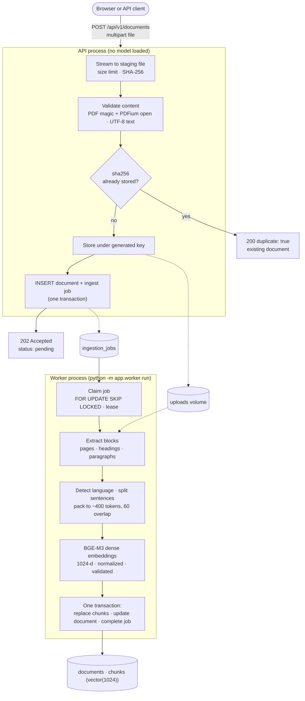
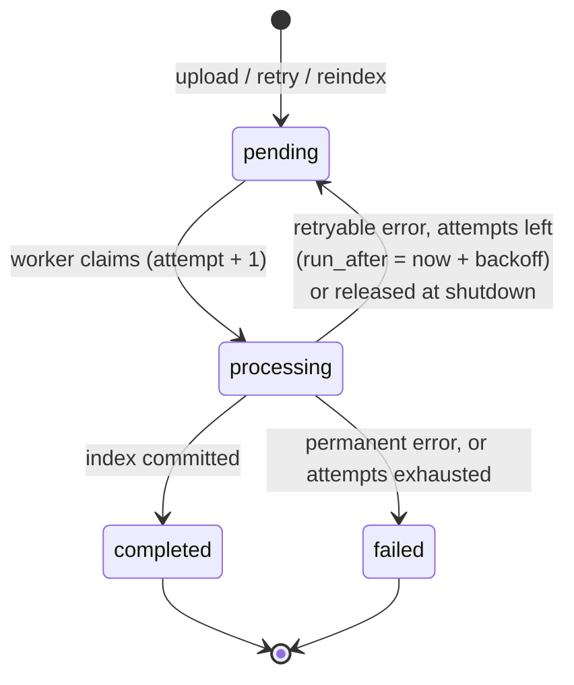

# Ingestion pipeline

How an uploaded document becomes chunks with embeddings (Phase 2). Retrieval over those
chunks, chat, citations and evaluation are **not implemented**; this pipeline only builds
and maintains the index.

Related decisions: [ADR 0003 (local BGE-M3)](decisions/0003-local-bge-m3.md) ·
[ADR 0004 (document storage)](decisions/0004-document-storage.md) ·
[ADR 0002 (PostgreSQL + pgvector)](decisions/0002-postgres-pgvector.md)

## Overview



The API and the worker are separate processes that share only PostgreSQL and the file
storage. The API never imports PyTorch or loads the model, so it starts fast and stays small;
the worker can be restarted, scaled or moved to a machine with a GPU on its own.

## Upload and validation

`POST /api/v1/documents` takes one `multipart/form-data` field named `file`.

1. **Request size.** A middleware rejects bodies over `MAX_UPLOAD_BYTES` plus a small
   multipart allowance with `413`, using `Content-Length` when present and counting bytes
   when it is not. The file itself is checked against `MAX_UPLOAD_BYTES` (20 MiB) exactly
   while it is streamed to a staging file and hashed.
2. **Type.** The extension (`.pdf`, `.md`, `.markdown`, `.txt`) selects what the content is
   *expected* to be; the content decides whether it is accepted:
   - PDF: `%PDF-` must appear in the first 1024 bytes, PDFium (pypdfium2) must open the file, it must
     not be encrypted or password-protected, and it must have at least one page;
   - Markdown and text: must decode as UTF-8 (a BOM is allowed) and contain no NUL bytes.
   A renamed binary, a PDF named `.txt`, an empty file, or an unsupported extension is
   rejected with `415` or `422` and a specific error code. No document is created.
3. **Deduplication.** If an uploaded document with the same SHA-256 exists, the response
   is `200` with `"duplicate": true` and that document. See ADR 0004 for the concurrent
   case. Since Phase 5, documents imported by S3 connectors are not part of this check
   ([connectors.md](connectors.md)); they enter the same pipeline from the worker.
4. **Storage.** The file is stored under a generated key; the sanitized original filename
   is metadata only.
5. **Queueing.** The document row (status `pending`) and an `ingest` job are inserted in one
   transaction. The response is `202` with a `Location` header pointing at the document.

Scanned PDFs pass validation (they are valid PDFs) and fail in the worker with
`no_extractable_text`, because there is no OCR.

## Job lifecycle



A job row is immutable once `completed` or `failed`; retry and reindex create a **new** job.
A partial unique index allows at most one `pending` or `processing` job per document, so
double-clicking *Retry* cannot queue two jobs.

The document mirrors the job:

| Document status | Meaning |
| --- | --- |
| `pending` | Waiting for a worker (new, retry scheduled, or reindex requested) |
| `processing` | A worker holds the job |
| `completed` | Chunks and embeddings are stored. `chunk_count > 0`, `processed_at`, the model name and the model revision are set (enforced by database CHECK constraints) |
| `failed` | No usable index. `chunk_count = 0` and `error_code` is set (enforced by CHECK constraints) |

### Claiming, leases and recovery

- A worker claims the oldest runnable job (`run_after <= now()`) with
  `SELECT … FOR UPDATE SKIP LOCKED`, so concurrent workers never claim the same job.
- The claim sets `lease_expires_at = now() + WORKER_LEASE_SECONDS` and a fresh random
  `lease_token`. While working, the worker renews the lease every
  `WORKER_HEARTBEAT_SECONDS`.
- Every later write (renew, complete, fail, release) is conditional on the same
  `lease_token`. A worker that lost its lease cannot overwrite the result of whoever took the
  job over; it logs `job_lease_lost` and drops its work.
- Before claiming, every worker looks for `processing` jobs whose lease has expired (a
  worker crashed or was killed) and treats each as a failed, retryable attempt with
  `worker_lost`. A job that keeps killing workers therefore stops after
  `WORKER_MAX_ATTEMPTS`.
- **Graceful shutdown.** On `SIGTERM`/`SIGINT` the worker stops claiming and waits up to
  `WORKER_SHUTDOWN_GRACE_SECONDS` for in-flight jobs. Jobs still running after that are
  released back to `pending` without using an attempt. Compose gives the container 45
  seconds before killing it.
- **Concurrency** is bounded by `WORKER_CONCURRENCY` (default 1). Embedding runs in a
  thread so the event loop keeps renewing leases while the model works.

### Idempotency and atomic completion

All work before the final write is side-effect free: extraction, chunking and embedding
happen in memory. The final write is one transaction that deletes the document's existing
chunks, inserts the new ones, updates the document (status, counts, language, page count,
model name, model revision, dimension) and completes the job, guarded by the lease token.
Running the same job twice produces the same chunks, and a reader sees either the old index
or the new one, never a mixture.

### Retry and reindex

| Endpoint | Allowed from | Effect |
| --- | --- | --- |
| `POST /api/v1/documents/{id}/retry` | `failed` | New `ingest` job; document back to `pending` |
| `POST /api/v1/documents/{id}/reindex` | `completed` or `failed` | New `reindex` job; document back to `pending` |

Anything else returns `409` with `invalid_document_state`.

**Reindex keeps the old index until the new one succeeds.** During a reindex the existing
chunks stay in place (and `GET /{id}/chunks` keeps returning them). If the reindex
succeeds, they are replaced in the completion transaction. If it fails permanently, the
document returns to `completed` with its previous chunks, and `error_code` /
`error_message` explain that reindexing failed and the previous index is still in use.

## Errors and retries

Retryable errors are retried with exponential backoff: `WORKER_RETRY_BACKOFF_SECONDS`
(default 30 s), doubled each attempt, capped at one hour, up to `WORKER_MAX_ATTEMPTS`
(default 3). Permanent errors fail the job on the first attempt.

| Code | Where | Retryable | Meaning |
| --- | --- | --- | --- |
| `unsupported_file_type` | upload (415) | – | Extension is not `.pdf`, `.md`, `.markdown` or `.txt` |
| `content_type_mismatch` | upload (415) | – | Content does not match the extension (for example a renamed binary) |
| `empty_file` | upload (422) | – | Zero bytes, or a PDF with no pages |
| `file_too_large` | upload (413) | – | Over `MAX_UPLOAD_BYTES` |
| `invalid_encoding` | upload (422) | – | Text or Markdown that is not UTF-8, or contains NUL bytes |
| `encrypted_pdf` | upload (422) | – | Password-protected or encrypted PDF |
| `malformed_pdf` | upload (422) | – | PDFium cannot open the PDF |
| `no_extractable_text` | worker | no | No text layer (for example a scanned PDF; OCR is not supported) |
| `extraction_failed` | worker | no | The file opened at upload but text extraction failed |
| `stored_file_missing` | worker | no | The stored original is gone |
| `input_too_long` | worker | no | A chunk exceeds the model's input limit (should not happen; chunks are sized by the same tokenizer) |
| `invalid_embedding` | worker | no | Wrong count or dimension, non-finite values, or not unit length |
| `embedding_model_unavailable` | worker | yes | Weights could not be downloaded or loaded |
| `embedding_failed` | worker | yes | The model raised an error while encoding |
| `worker_lost` | worker | yes | The lease expired (worker crashed or was killed) |
| `internal_error` | worker | yes | Any unexpected exception; details go to the logs only |

Upload errors use the API's standard envelope,
`{"error": {"code", "message", "request_id"}}`. Worker errors are stored on the document
(`error_code`, `error_message`) and the job (`last_error_code`, `last_error_message`).
Messages are short, written for users, and never contain paths or stack traces.

## Extraction

| Format | Library | What is kept |
| --- | --- | --- |
| PDF | pypdfium2 (Google PDFium; BSD-3-Clause / Apache-2.0) | Text lines in content order with their **page number**, grouped into paragraphs by vertical spacing and font size; text outside the page's media box is dropped; words hyphenated across lines are re-joined; the PDF outline (table of contents), when present, supplies the section for each page |
| Markdown | built-in parser | Paragraphs; ATX (`#`) and setext headings, tracked as a heading path such as `Guide > Install`; `#` lines inside fenced code are not mistaken for headings |
| Plain text | built-in | Blank-line separated paragraphs; a short one-line paragraph that does not end in punctuation is treated as a heading |

Line breaks inside a paragraph are joined with a space between Latin words and **without**
a space when either side is a Japanese (CJK) character, so Japanese text wrapped across lines
is not broken up by stray spaces, including before numbers and Latin words.

PDFium is not thread-safe. The API (validation) and the worker (extraction) call it from
threads, so all PDFium use goes through `app/ingestion/pdf.py`, which serializes it with a
process-wide lock. A large PDF being extracted therefore briefly delays PDF validation in the
same process; the API and worker are separate processes, so they do not block each other.

## Chunking

Sizes are measured in **tokens of the embedding model's own tokenizer**, so a chunk that the
chunker accepts is guaranteed to fit the model.

| Setting | Default | Meaning |
| --- | --- | --- |
| `CHUNK_TARGET_TOKENS` | 400 | Chunks are packed up to this size |
| `CHUNK_OVERLAP_TOKENS` | 60 | Whole sentences from the end of the previous chunk are repeated, up to this many tokens |
| `CHUNK_MIN_TOKENS` | 40 | A trailing chunk with less new content than this is merged into the previous one; hard cap is target + min (440) |

1. **Language detection** (`app/ingestion/language.py`) counts letters by script:
   hiragana, katakana and CJK ideographs count as Japanese, Latin letters count half (one
   Japanese character carries roughly as much as a few Latin letters). A share of Japanese of
   at least 0.8 is `ja`, at most 0.2 is `en`, anything between is `mixed`, and text with no
   letters is `unknown`. Each chunk and the whole document get a language.
2. **Sentence splitting** ends sentences at `。`, `！`, `？`, `．` and at a line break
   immediately, and at `.`, `!` or `?` when followed by whitespace or the end of the text (so
   `3.14` stays intact; `!` or `?` directly followed by Japanese also ends a sentence).
   Closing quotes and brackets such as `」` stay on the sentence they close. Japanese is never
   split on whitespace, because it has none.
3. **Long sentences** that alone exceed the target are split at clause punctuation (`、`,
   `，`, `,`, `;`, `:` and their full-width forms) or whitespace, and only as a last resort by a binary search for
   the longest prefix that fits. Text is never dropped or silently truncated.
4. **Packing** adds sentences greedily while the exact token count of the joined chunk stays
   within the target.
5. **Headings** start a new chunk (without overlap) when the current chunk already holds a
   meaningful amount of new content, so chunks tend not to straddle sections. Each chunk
   records its section (the heading path) and its first and last page.
6. **No tiny trailing chunks.** The last chunk of a document is merged into the one before
   it if it carries less than `CHUNK_MIN_TOKENS` of new content and the merge stays within
   the hard cap.

`CHUNK_TARGET_TOKENS + CHUNK_MIN_TOKENS + 2` must not exceed `EMBEDDING_MAX_SEQ_LENGTH`
(default 1024); the settings refuse to start otherwise.

## Embeddings

See [ADR 0003](decisions/0003-local-bge-m3.md). In short: BAAI/bge-m3 dense output, CLS
pooling, L2-normalized, 1024 dimensions, encoded in batches of `EMBEDDING_BATCH_SIZE`, and
every vector validated before it is stored. The model is loaded once per worker process,
lazily on the first job (or at startup with `WORKER_PRELOAD_MODEL=true`).

## Schema

Migration `0002_documents` (in `backend/alembic/versions/`) adds:

**`documents`**: `id`, `filename` (sanitized original name), `file_type`, `mime_type`,
`size_bytes`, `sha256` (unique among uploads since Phase 5), `source_type` (`upload` or `s3`), `storage_key` (unique), `language`, `page_count`,
`status`, `error_code`, `error_message`, `chunk_count`, `embedding_model`,
`embedding_model_revision`, `embedding_dimension`, `created_at`, `updated_at`,
`processed_at`. CHECK constraints enforce the status values, the completed and failed
invariants above, a positive size and a lowercase-hex SHA-256.

**`chunks`**: `id`, `document_id` (cascade delete), `ordinal` (unique per document),
`text`, `token_count`, `language`, `page_start`, `page_end`, `section`,
`embedding vector(1024)`, `created_at`.

**`ingestion_jobs`**: `id`, `document_id` (cascade delete), `kind` (`ingest`/`reindex`),
`status`, `attempts`, `max_attempts`, `run_after`, `locked_by`, `lease_token`,
`lease_expires_at`, `heartbeat_at`, `last_error_code`, `last_error_message`, `request_id`
(the upload request's ID, reused as the worker's log correlation ID), timestamps. Indexes
support claiming (`status`, `run_after`), lease recovery, and the one-active-job-per-document
rule.

There is **no approximate nearest-neighbour index** on `chunks.embedding` yet. The index type
and parameters (HNSW or IVFFlat) will be chosen with measurements once retrieval exists
(see ADR 0002).

## Observability

The worker logs one JSON object per line, like the API. Every log line written while a job
runs carries `request_id` (the ID of the upload, retry or reindex request that queued the
job), plus `job_id`, `document_id`, `job_kind` and `attempt`. Events include
`job_started`, `job_completed` (with chunk count and duration),
`job_attempt_failed`, `job_failure_recorded`, `job_lease_expired`, `job_lease_lost`,
`job_released`, `jobs_recovered` and `orphaned_files_removed`.

**Health.** The worker writes a heartbeat file every few seconds when
`WORKER_HEARTBEAT_FILE` is set (it is in the Docker image).
`python -m app.worker healthcheck` exits non-zero if the file is missing or older than 60
seconds; the image's `HEALTHCHECK` uses it.

## Worker commands

```bash
python -m app.worker run              # process jobs until SIGTERM / SIGINT
python -m app.worker prepare-model    # download the model into MODEL_CACHE_DIR, print the revision
python -m app.worker healthcheck      # exit 0 if the worker heartbeat is fresh
```

## Troubleshooting

| Symptom | Likely cause and fix |
| --- | --- |
| Documents stay `pending` | No worker is running. `docker compose ps worker`, `docker compose logs worker`. Outside Docker: `uv run --extra embeddings python -m app.worker run` |
| `embedding_model_unavailable` | The worker cannot download the model (no network, a proxy, or `EMBEDDING_LOCAL_FILES_ONLY=true` with an empty cache). Run `prepare-model` where the Hub is reachable, then retry the document |
| `sentence-transformers and torch are not installed` in the worker log | The worker environment lacks the extra: `uv sync --extra embeddings` |
| Worker container restarts or is `OOMKilled` | The model needs more memory than `WORKER_MEMORY` allows; raise it (6 GB is the default) or lower `EMBEDDING_BATCH_SIZE` |
| Very slow ingestion on a Mac | Docker cannot use the Apple GPU. Run the worker on the host with `EMBEDDING_DEVICE=auto` (see the README) |
| `no_extractable_text` | The PDF has no text layer (scanned). OCR is not supported |
| Upload returns `200` with `duplicate: true` | The same content already exists; the response links to it |
| Settings error mentioning `EMBEDDING_PROVIDER=fake` | The fake provider is only accepted with `ENVIRONMENT=test` |

## Limitations

- No OCR, so scanned PDFs fail. No table structure or image extraction.
- Only PDF, Markdown and plain text. No Word, HTML or EPUB.
- Dense vectors only; no sparse or multi-vector (ColBERT) output, no keyword index yet.
- No ANN index; nothing reads the vectors yet because retrieval is not implemented.
- One global deduplication namespace and no ownership, because there is no authentication.
- The orphan file sweep runs only at worker startup.
- Real BGE-M3 has been verified on CPU only (see ADR 0003); MPS has not been tested.
