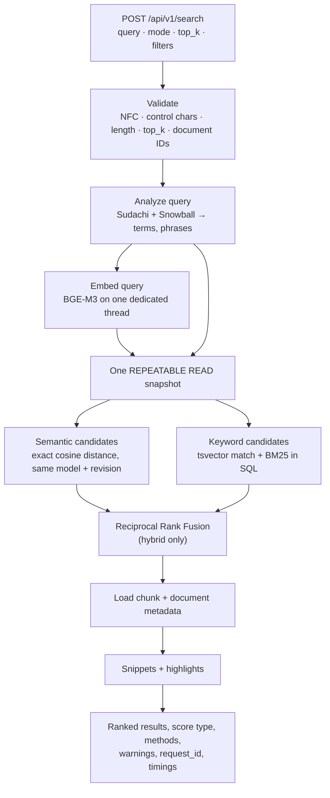

# Retrieval (Phase 3)

YashRAG can search the chunks of indexed documents in three ways:

| Mode | Finds | Score |
| --- | --- | --- |
| `semantic` (default) | Chunks whose meaning is close to the query, in either language | Cosine similarity (−1 to 1) |
| `keyword` | Chunks containing the query's words or quoted phrases | Okapi BM25 (0 or more) |
| `hybrid` | Both, merged | Reciprocal Rank Fusion |

Semantic is the default because it scored best on the evaluation set (nDCG@10 0.927, against
0.874 for hybrid and 0.802 for keyword, with the real model). `SEARCH_DEFAULT_MODE` changes
the default; every request can still choose a mode.

Search returns stored chunks only. Nothing is generated: the snippet is a verbatim excerpt
of the chunk, and highlights mark the words that matched. Answer generation is a later
phase.

Decisions behind this design: [ADR 0005](decisions/0005-bilingual-keyword-search.md)
(keyword engine) and [ADR 0006](decisions/0006-hybrid-retrieval.md) (exact vector search,
fusion, no reranker). Measured quality and latency: [evaluation/](evaluation/README.md).

## Request flow



All database reads for one search run in a single `REPEATABLE READ` snapshot, which is then
rolled back (nothing is written). A document that is deleted or reindexed during the search
is therefore either fully in the results or fully out, never half.

## Indexing

Each chunk row carries both indexes, written in the same transaction by the ingestion
worker:

| Column | Contents | Index |
| --- | --- | --- |
| `chunks.embedding` | `vector(1024)`, BGE-M3 dense embedding (unit length) | none: exact search ([ADR 0006](decisions/0006-hybrid-retrieval.md)) |
| `chunks.search_vector` | `tsvector` of analyzer terms with positions | GIN `ix_chunks_search_vector` |
| `chunks.search_length` | Number of indexed term occurrences (BM25 document length) | — |

Migration `0003_keyword_search` adds the two keyword columns and fills them for existing
chunks, so documents indexed in Phase 2 are searchable by keyword without reindexing. A
document that is being reindexed keeps serving its previous chunks until the new ones
replace them atomically.

`python -m app.worker rebuild-search-index` recomputes every `search_vector`, which is
needed only after an analyzer change (`ANALYZER_VERSION` in `app/search/analyzer.py`).

## Keyword search

**Analysis** (`app/search/analyzer.py`, details in ADR 0005):

- Japanese: SudachiPy split mode C, plus mode A parts of compounds at the same positions;
  terms are Sudachi's normalized form (`サーバ` and `サーバー` match). Particles, auxiliary
  verbs and symbols are dropped.
- Latin script: NFKC, case folding, English stopwords removed, Snowball stemming
  (`backups` matches `backup`; `ＶＰＮ` matches `VPN`).
- A query in `"..."`, `“...”` or `「...」` is a phrase: the words must appear next to each
  other in that order (a `tsquery` with `<N>` distance operators).

The analysis of each query is returned as `query_terms` in the response.

**Matching and ranking** (`keyword_candidates` in `app/search/retrieval.py`): a chunk is a
candidate if it contains at least one query term and every quoted phrase. Candidates are
ranked by Okapi BM25:

```
score = Σ over query terms t in the chunk:
        ln(1 + (N − df(t) + 0.5) / (df(t) + 0.5))
        × tf(t) × (k1 + 1) / (tf(t) + k1 × (1 − b + b × len / avglen))
```

`tf` comes from the term's stored positions, `df`, `N` and `avglen` from all indexed chunks
(so a document filter narrows results without changing scores), k1 = 1.2 and b = 0.75.
Equal scores are ordered by chunk ID, so the same query always gives the same order.

## Semantic search

- The query is embedded with the same provider class, model name and revision as the
  chunks (BGE-M3, CLS pooling, normalized), in the API process. The model is loaded once,
  on a dedicated thread, so inference never blocks the event loop. With
  `SEARCH_PRELOAD_MODEL=true` it is loaded in the background at startup.
- Candidates are ordered by pgvector's cosine distance (`<=>`), exactly, with no ANN index,
  and ties broken by chunk ID. Similarity is reported as `1 − distance`.
- Only chunks of documents embedded with the **same model, revision and dimension** as the
  query are compared. If other indexed documents exist, a warning says how many were
  skipped and that they need a reindex.
- `min_similarity` drops candidates below a cosine similarity. Without it, semantic search
  always returns its nearest chunks, even when none is relevant.

**Failures.** If the model cannot be loaded (not downloaded, `EMBEDDING_LOCAL_FILES_ONLY`
without a cache, out of memory), semantic search returns `503 semantic_search_unavailable`
and hybrid search returns keyword results with `semantic_available: false` and a warning.
After a failed load, the next attempt waits 30 seconds, so a broken model is not reloaded on
every request. A search waits at most `SEARCH_MODEL_LOAD_WAIT_SECONDS` (default 20) for a
load in progress, then answers the same way while the load continues.

## Hybrid search and fusion

Hybrid search takes up to `SEARCH_FUSION_DEPTH` (default 50, at least `top_k`) candidates
from each method and merges them with **Reciprocal Rank Fusion**:

```
rrf(chunk) = Σ over methods that returned the chunk: 1 / (k + rank)      k = SEARCH_RRF_K = 60
```

- Only ranks are used, so cosine similarities and BM25 scores never need a common scale.
- A chunk found by both methods appears once, with both ranks in `semantic` and `keyword`.
- Ties are broken by the best single rank, then by chunk ID.
- The fused score is a rank statistic: for k = 60 the maximum is 2/61 ≈ 0.0328 (first in
  both lists). It is not a probability or a similarity, and the response says so in
  `score_description`.

No reranker runs after fusion; see ADR 0006 for why.

## API

### `POST /api/v1/search`

Request body (unknown fields are rejected):

| Field | Type | Default | Notes |
| --- | --- | --- | --- |
| `query` | string | required | NFC-normalized; control characters removed; NUL rejected; at most `SEARCH_MAX_QUERY_CHARS` (1000) characters |
| `mode` | `semantic` · `keyword` · `hybrid` | `SEARCH_DEFAULT_MODE` (`semantic`) | the response's `mode` says which was used |
| `top_k` | integer ≥ 1 | `SEARCH_DEFAULT_TOP_K` (10) | at most `SEARCH_MAX_TOP_K` (50) |
| `document_ids` | list of UUIDs | all documents | 1 to 100, no duplicates; any unknown ID → `422 unknown_document` |
| `language` | `ja` · `en` · `mixed` | any | filters on each chunk's detected language |
| `min_similarity` | number −1…1 | none | semantic and hybrid only; with `keyword` → `422 invalid_filter` |

Example:

```bash
curl -s localhost:8000/api/v1/search -H 'Content-Type: application/json' \
  -d '{"query": "在宅勤務の申請期限", "mode": "hybrid", "top_k": 5}'
```

Response (abridged):

```json
{
  "query": "在宅勤務の申請期限",
  "mode": "hybrid",
  "score_type": "rrf",
  "score_description": "Reciprocal Rank Fusion score: the sum of 1 / (k + rank) ...",
  "top_k": 5,
  "results": [
    {
      "rank": 1,
      "score": 0.0328,
      "chunk_id": "…", "document_id": "…",
      "filename": "remote-work.md", "file_type": "markdown",
      "document_language": "ja", "page_count": null,
      "chunk_ordinal": 2, "language": "ja",
      "page_start": null, "page_end": null, "section": "在宅勤務規程 > 申請手続き",
      "text": "在宅勤務を行う場合は、前日の17時までに勤怠システムで申請し、…",
      "snippet": "在宅勤務を行う場合は、前日の17時までに勤怠システムで申請し、…",
      "snippet_start": 0,
      "highlights": [[0, 4], [27, 29], [71, 73]],
      "retrieval_methods": ["semantic", "keyword"],
      "semantic": {"rank": 1, "score": 0.71},
      "keyword": {"rank": 1, "score": 6.2}
    }
  ],
  "query_terms": ["在宅勤務", "在宅", "勤務", "申請期限", "申請", "期限"],
  "semantic_available": true,
  "warnings": [],
  "request_id": "…",
  "timings_ms": {"analyze_ms": 0.4, "embed_ms": 38.0, "semantic_ms": 6.1,
                 "keyword_ms": 3.2, "snippets_ms": 0.3, "total_ms": 49.8}
}
```

The terms and highlight offsets are what the analyzer produces for this query and chunk;
the scores and timings only illustrate the shape and are not measurements.

`highlights` are `[start, end)` character offsets into `snippet`; `snippet_start` is the
snippet's offset in `text`. The snippet is the window of at most `SEARCH_SNIPPET_CHARS`
(280) characters with the most matched terms, moved back to the start of a word or sentence when one is within 20 characters.

Errors use the standard body `{"error": {"code", "message", "request_id"}}`:

| Status | Code | When |
| --- | --- | --- |
| 422 | `validation_error` | Empty query, NUL, bad mode, bad UUID, duplicate IDs, unknown field |
| 422 | `invalid_top_k` | `top_k` above the maximum |
| 422 | `query_too_long` | Too many characters, or more tokens than the model accepts |
| 422 | `invalid_filter` | `min_similarity` with keyword mode |
| 422 | `unknown_document` | A `document_ids` entry does not exist |
| 503 | `semantic_search_unavailable` | Semantic mode and the model cannot be used |
| 503 | `database_unavailable` | The database query failed |

Error messages never include stack traces, SQL, hosts or credentials; database errors are
logged with their type only.

### `GET /api/v1/search/options`

Modes, defaults and limits (`default_mode`, `default_top_k`, `max_top_k`, `max_query_chars`, `rrf_k`,
`fusion_depth`), so a client can validate before searching.

## Frontend

The **Search** page (`/search`) has the query box, a mode selector (Semantic, Hybrid,
Keyword; it starts on the server's default mode), a document filter and a
passage-language filter. The query, mode and filters live
in the URL, so a search can be bookmarked or shared and the back button works.

Each result card shows the rank, file name (a link to the document page, scrolled to the
matching chunk), pages, chunk number, language, section, the score with its type, and which
methods found it with their ranks ("Semantic #2", "Keyword #1"). The snippet shows matched
words highlighted, and "Show the full chunk" expands the whole chunk. The page has loading,
error (with the request ID, and a "Search by keyword instead" button when semantic search is
unavailable), warning and empty states. It is usable with the keyboard alone (the mode
selector is a radio group) and on narrow screens.

## Configuration

| Variable | Default | Meaning |
| --- | --- | --- |
| `SEARCH_DEFAULT_MODE` | semantic | Mode when a request does not name one |
| `SEARCH_DEFAULT_TOP_K` | 10 | Results when `top_k` is not given |
| `SEARCH_MAX_TOP_K` | 50 | Upper limit for `top_k` |
| `SEARCH_MAX_QUERY_CHARS` | 1000 | Query length limit |
| `SEARCH_FUSION_DEPTH` | 50 | Candidates per method for hybrid fusion |
| `SEARCH_RRF_K` | 60 | RRF constant |
| `SEARCH_BM25_K1`, `SEARCH_BM25_B` | 1.2, 0.75 | BM25 parameters |
| `SEARCH_SNIPPET_CHARS` | 280 | Snippet length |
| `SEARCH_PRELOAD_MODEL` | false (true in Compose) | Load the model at API startup |
| `SEARCH_MODEL_LOAD_WAIT_SECONDS` | 20 | How long a search waits for a model load |

The API uses the same `EMBEDDING_*` settings as the worker. They must name the same model
and revision, or semantic search skips the documents (and says so in a warning).

## Known limitations

- **Exact vector search scales linearly.** Every semantic search reads every compatible
  embedding. ADR 0006 records measured latencies and the point where an HNSW index becomes
  worth its recall loss.
- **BM25 statistics are computed per query** (`N`, average length and document
  frequencies), which is a scan over all chunks. Fine at the sizes measured; a term
  statistics table would be needed for millions of chunks.
- **Keyword search does not cross languages.** `password` does not match `パスワード`;
  semantic and hybrid search cover that.
- **Semantic search always returns something** unless `min_similarity` is set, including
  for questions the documents cannot answer. Hybrid search inherits this. The evaluation
  reports how often this happens.
- **Scores are per query.** BM25 and RRF scores cannot be compared across queries or used
  as a confidence threshold.
- **Two copies of the model** when running the API and worker as separate processes (about
  2.3 GB of RAM each on CPU).
- **The first semantic search after startup can be slow** if the model is not yet loaded;
  it waits at most `SEARCH_MODEL_LOAD_WAIT_SECONDS`.
- **Unknown words are split** by the Sudachi dictionary into shorter units. They are still
  found, but matching can be looser than intended.
- **No access control.** Every document is searchable by every client, as for the rest of
  the API so far.
